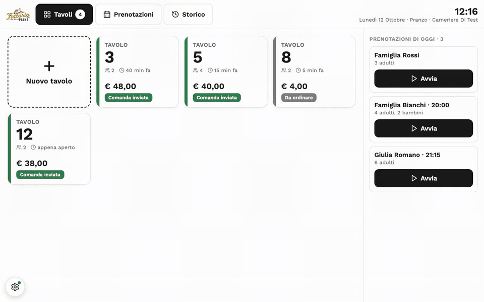
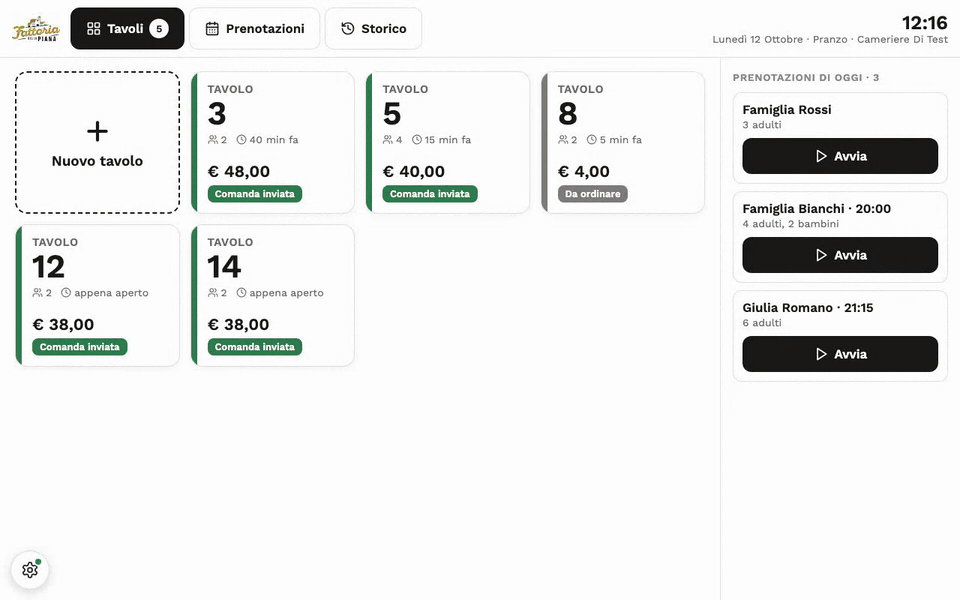
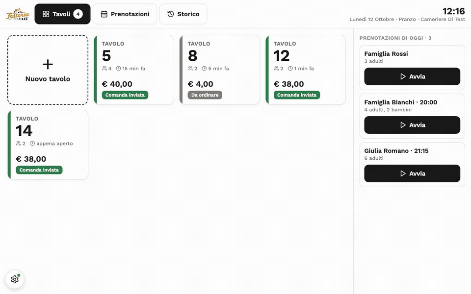
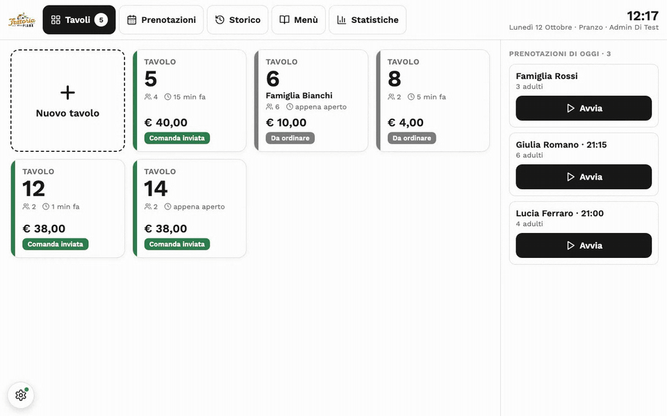

# Masseria della Piana — Digital Menu

A React + Firebase digital menu for a real restaurant (Masseria della Piana,
an agriturismo in Candidoni, RC): a public multi-language menu for
customers, plus a restricted staff area for menu management, digital order
taking (waiter/kitchen), table reservations, and sales statistics.

Built as freelance work and running in production — used daily by the
restaurant for the customer-facing menu and for internal order and
reservation management.

This README is the technical entry point for developers. For other
audiences:
- [`GUIDA.md`](GUIDA.md) (Italian) — non-technical setup guide for the
  restaurant owner, covering the real Firebase project, Cloudinary, and
  deployment.
- [`CLAUDE.md`](CLAUDE.md) — project conventions for AI coding agents
  (testing, deploy pipeline, concurrent-session etiquette).
- [`ROADMAP.md`](ROADMAP.md) (Italian) — backlog of planned improvements.
- [`docs/architecture.md`](docs/architecture.md) — module map and the
  reasoning behind the current architecture.
- [`docs/data-model.md`](docs/data-model.md) — the Firestore schema.
- [`docs/stampa-scontrini.md`](docs/stampa-scontrini.md) (Italian) — the
  Windows till client and receipt printing on the thermal printer.
- [`docs/comande-camerieri.md`](docs/comande-camerieri.md) and
  [`docs/prenotazioni.md`](docs/prenotazioni.md) (Italian) — detailed design
  docs for the order-taking and reservations features.
- [`docs/testing.md`](docs/testing.md) (Italian) — running the E2E tests
  (only the touched part while developing, the full suite at the end) and
  the rules that keep them deterministic.

## Live demo

- **Public menu:** [menu.masseria-della-piana.it](https://menu.masseria-della-piana.it/)
- **Restaurant landing page:** [masseria-della-piana.it](https://www.masseria-della-piana.it/)

These are the real production environments. Staff-only areas (order
taking, kitchen, reservations, admin) require staff credentials and aren't
publicly accessible — to try them without access to the real project, see
[Try it locally](#try-it-locally-no-real-credentials-needed) below.

## What the till looks like

<details>
<summary>Show the till client in action (4 GIFs)</summary>

Recorded against the local emulator with demo data (`npm run demo:gifs`,
see [`demo/README.md`](demo/README.md)); the orange circles mark each tap.

**Tables and order:** floor grid, new table from the on-screen keypad, dish
tiles by category, a note on a line from the side panel, send to the kitchen.



**Bill:** a 20% discount on one line, the pre-bill printed at the till,
closing the table, the history with reprint.



**Reservations:** times picked with a tap, saved already confirmed, then a
reservation started straight into its table.



**Admin at the till:** statistics with period comparison, menu management.



</details>

## Windows till client — download

**[⬇ Download Masseria-Cassa-Setup.exe](https://github.com/Octavian-Alexandru-Dev/menu-masseria/releases/latest/download/Masseria-Cassa-Setup.exe)**
(Windows 10/11, 64-bit — always the latest release)

The till client (`desktop-client/`, Electron) wraps the same staff web app
in a fullscreen window for the 12" touch terminal at the till, and prints
receipts sent from any staff device (waiters' phones included) directly on
the thermal printer. The UI is loaded from the live site, so a normal
hosting deploy updates the till too — a new installer is only needed when
the client itself changes, and from 1.1.0 the client installs those by
itself (electron-updater, from GitHub Releases), so the link above is only
needed for a first install. The installer isn't code-signed: Edge may block
the download (*⋯ → Keep → Keep anyway*) and on first run Windows SmartScreen
shows "Windows protected your PC" → *More info* → *Run anyway*. Setup, printer settings and troubleshooting:
[`docs/stampa-scontrini.md`](docs/stampa-scontrini.md).

## Features

- **Multilingual public menu** (IT/EN/ES/DE/FR): translations are generated
  once from the menu settings (editable by hand) and read by the client with
  no network call on language switch.
- **Real-time order flow**: the waiter sends the order from their phone or
  from the till; every staff device sees it instantly (Firestore realtime
  listeners). The kitchen gets a **printed ticket** at the till with only the
  dishes flagged "In comanda" in the menu (drinks excluded), big bold text,
  no prices, minimal paper (`kitchenTicket.js`, `escpos.js`). There is no
  kitchen screen: the kitchen works from the printed tickets.
- **Receipt printing at the till**: "Stampa" on a receipt, from any staff
  device, queues a print job (`printJobs` in Firestore) that the Windows
  till client prints as ESC/POS on the 80mm thermal printer, with live
  status back on the device that asked (`printJobs.js`, `escpos.js`,
  `PrintStation.jsx`, `desktop-client/`).
- **Staff app for phones** (`PhoneApp.jsx`): installable, with the sections
  in a bottom navigation bar (Tables, Reservations, History, Menu,
  Statistics), order taking by taps on dish tiles with a fixed bottom bar,
  full-screen pages for the ticket, line edits and every editor.
- **Till interface**: inside the Windows client the same staff area becomes
  a full-screen touch POS (`TillSala.jsx`: tables grid, order with
  in-context line editing — quantity, offered, discounts). Reservations,
  history, menu management and statistics are the same screens on the till
  and on phones (`Till*.jsx`, laid out by screen size), all built from
  shared pieces (`TillUi.jsx`, `OrderUi.jsx`) and the same data layer.
- **Table reservations**: month calendar with bookings and covers per day,
  booking slots, confirm/reject/cancel, start a booked table.
- **Menu management**: dishes and categories (price from an on-screen
  keypad, availability, off-menu, kitchen ticket, internal cost, photo),
  identity and theme, review/social links, translations (automatic for
  missing texts, editable by hand), staff accounts and roles, a
  configurable printable menu (PDF), JSON backup and restore — every
  "Salva" writes only what changed, in a transaction on the live menu.
- **Sales and usage statistics** for admins (`TillStats.jsx`): presets or
  custom dates, comparison with another period, rankings by dish, category,
  waiter, hour and weekday.
- **SEO**: meta tags, Open Graph/Twitter Card, `schema.org/Restaurant`
  structured data, sitemap.

## Stack

- **React 18** + **Vite** — no framework/router beyond a hand-rolled
  `useUrlState` hook (see `src/shared.jsx`) that syncs a couple of pieces of
  UI state with the URL query string.
- **Firestore** (realtime listeners, persistent local cache) for all data;
  **Firebase Authentication** (email/password) for the staff area.
- **Cloudinary** for dish photo uploads (unsigned, client-side).
- **Playwright** for end-to-end tests, run against a local, containerized
  Firebase emulator — never against the real project.
- Plain JavaScript throughout (no TypeScript), plain inline styles (no CSS
  framework) — see `src/shared.jsx`'s `THEMES`/`TYPE`/`SPACE` tokens for the
  design system.

## Try it locally (no real credentials needed)

The app runs entirely against a containerized Firebase emulator,
pre-seeded with a demo menu and test staff accounts — no real Firebase
project required:

```bash
npm install
docker compose -f docker-compose.emulator.yml up -d --wait   # Firestore + Auth emulator, pre-seeded
npm run dev:local
```

Open the URL printed in the console. Staff accounts available in the
emulator (fixed, non-sensitive credentials — valid only locally, seeded by
`scripts/seed-emulator.js`):

| Role | Email | Password |
|---|---|---|
| Admin | `admin@test.local` | `Test1234!` |
| Waiter | `waiter@test.local` | `Test1234!` |
| Kitchen | `kitchen@test.local` | `Test1234!` |

## Developing against the real Firebase project

To run `npm run dev` (not the emulator) you need a `.env` file with the
Firebase and Cloudinary config — see `GUIDA.md` for how to get these
values from the Firebase console. If you have access to the
`Menu-masseria` Bitwarden Secrets Manager project (see
`.bws-token.example`), `scripts/bws-env.sh` generates `.env` for you
instead of copying `.env.example` by hand.

## Common commands

| Command | What it does |
|---|---|
| `npm run dev` | Start the dev server against the Firebase project configured in `.env`. |
| `npm run dev:local` | Start the local Firebase emulator (Docker) + dev server, no `.env` needed. |
| `npm run build` | Production build (`vite build`) into `dist/`. |
| `npm run lint` | ESLint (see `eslint.config.js`). |
| `npm run test:e2e` | Full Playwright suite — self-contained, starts/seeds/tears down the emulator automatically. Requires Docker. |
| `npm run test:e2e:ui` | Playwright in interactive UI mode. |
| `npm run test:e2e:changed` | Only the E2E specs covering the files changed since the last commit (or `-- <spec names>`, `-- --list`). For day-to-day development; finish with the full suite. See [`docs/testing.md`](docs/testing.md). |
| `npm run emulators:up` / `emulators:down` | Start/stop the emulator container directly. |
| `npm run seed:emulator` | (Re-)seed the running emulator with demo data — idempotent. |
| `cd desktop-client && npm install && npx install-electron` | Install the till client's dependencies (also enables `tests/desktop-client.spec.js`). |
| `cd desktop-client && npm start` | Run the till client locally (settings: gear button bottom left → *Impostazioni stampante*). |
| `cd desktop-client && npm run dist:win` | Build the Windows installer into `desktop-client/dist/` (works from macOS too). |

See [`CLAUDE.md`](CLAUDE.md) for the full testing workflow, including when
to run the suite and how to handle a failing test after a change.

## Project structure

```
src/
  MenuApp.jsx        # app shell: routing (URL path/query), menu loading, menu writes (patch / restore)
  ClientView.jsx      # public menu (no Firebase Auth import — kept light)
  StaffHome.jsx         # staff entry: login + role, then PhoneApp (phones) or TillSala (till)
  PhoneApp.jsx          # staff app for phones: top bar + bottom navigation
  Waiter.jsx            # Tables and order screen on phones
  TillSala.jsx          # till: sections bar + tables and order screen
  TillReservations.jsx, TillHistory.jsx, TillMenu.jsx, MenuSettings.jsx, TillStats.jsx  # the other sections, same screen on phone and till
  TillUi.jsx, OrderUi.jsx  # shared UI pieces (buttons, panels, keypads; line editor, receipt…)
  PrintMenu.jsx         # printable menu (PDF)
  sala-shared.jsx       # Sala logic shared by Waiter.jsx and TillSala.jsx (draft, send, kitchen ticket…)
  PrintStation.jsx, printJobs.js, usePrintJob.js, escpos.js, kitchenTicket.js, desktop.js  # print queue + ESC/POS (station runs in the till client only)
  menuEdit.js, menuBackup.js, menuPrint.js, staffData.js  # menu edits as pure functions, backup, printable menu, staff accounts
  shared.jsx, staff-shared.jsx   # cross-cutting UI/data helpers, no Firebase (shared.jsx) vs. auth+role (staff-shared.jsx)
  orders.js, reservationsData.js, statsData.js, menuCosts.js  # Firestore data layer, one module per domain
  firebase-db.js, firebase-auth.js, cloudinary.js  # external service clients
desktop-client/  # Windows till client (Electron): fullscreen shell + raw TCP printing + settings window
docs/            # design docs and this technical documentation
scripts/         # emulator seeding/export scripts, Bitwarden env generation
tests/           # Playwright E2E specs + fixtures
seed-data/       # baked-in emulator snapshot (see docs/seed-data.md)
```

See [`docs/architecture.md`](docs/architecture.md) for how these fit
together and why the app stays a single deployable instead of being split
up.

## Deployment

On every push to `main`, GitHub Actions automatically publishes the app to
Firebase Hosting and updates Firestore security rules
(`.github/workflows/firebase-hosting-merge.yml`) — see the "Deploy —
firestore.rules" section in [`CLAUDE.md`](CLAUDE.md) for a gotcha worth
knowing (a rules change needs that workflow to run at least once before
it's live). The landing page (static, `landing_page/` folder) is published
separately via FTP to the Tophost hosting for the main domain, through a
local `pre-push` git hook (`.githooks/pre-push` +
`scripts/ftp-deploy-landing.sh`) — never from CI, since Tophost blocks FTP
from GitHub Actions runner IPs. Like the app's own `.env` (see
[Developing against the real Firebase project](#developing-against-the-real-firebase-project)),
the hook pulls the Tophost FTP credentials from the `Menu-masseria`
Bitwarden Secrets Manager project when `.bws-token` is present, falling
back to a local `.ftp-credentials` file otherwise (format in
`.ftp-credentials.example`).

The Windows till client is released separately: pushing a `cassa-v<version>`
tag (e.g. `git tag cassa-v1.0.1 && git push origin cassa-v1.0.1`) makes
`.github/workflows/desktop-client-release.yml` build the installer on a
Windows runner and publish it as the latest GitHub Release, which is what
the download link above points to.

Full operational documentation, written for the restaurant owner (no
technical prerequisites): [`GUIDA.md`](GUIDA.md).
